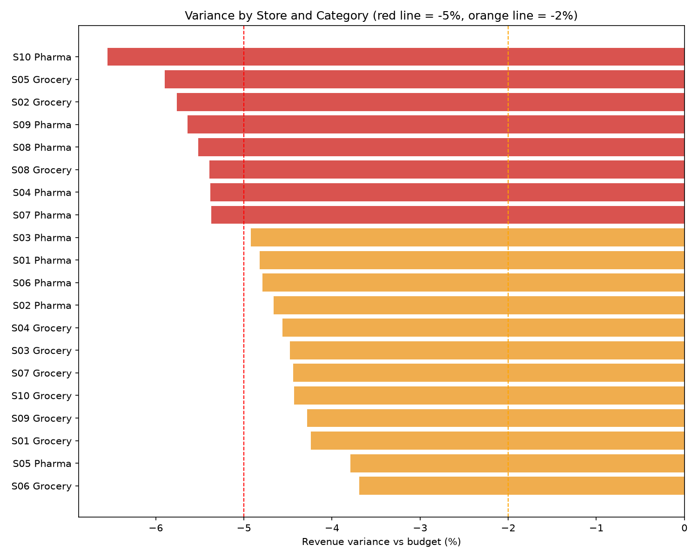

# Retail EPM Planning Engine

A Python project that simulates a retail planning cycle: build a budget from last year's history, compare it against actuals, and flag the exceptions. It is modelled on the budget vs actual workflow used in EPM tools like Board International.

All data is synthetic (generated by the script). It has the same structure as retail planning data, but no real company data is used.

## What it does

1. **Generates data** for 10 stores, 30 SKUs (12 pharma, 18 grocery) and 104 weeks of sales.
2. **Builds a budget** for FY2026 = same week in FY2025 + a growth assumption (`GROWTH` in `src/forecast.py`).
3. **Compares budget vs actual** by store, category and week.
4. **Flags exceptions**: RED at -5% or worse, AMBER between -5% and -2%, GREEN above -2%.
5. **Produces reports**: 3 charts and a colour-coded Excel exceptions report.

## Results (growth assumption = 5%)

- Total budget revenue: 368,019,458
- Total actual revenue: 350,130,398
- Total variance: -4.86%

The budget assumed +5% growth, but the data has flat demand, so the budget is too optimistic across the board. Setting `GROWTH = 0.00` removes the gap and all rows turn GREEN. This is the what-if scenario idea behind EPM planning tools.



## Project structure

```
retail_epm_engine/
  src/
    generate_data.py   creates the synthetic data
    forecast.py        builds the budget and calculates variance
    report.py          flags, charts and the Excel report
  data/                generated CSV files (not uploaded)
  outputs/             charts and Excel reports
  requirements.txt
```

## How to run

```
python -m venv venv
venv\Scripts\activate
pip install -r requirements.txt
python src\generate_data.py
python src\forecast.py
python src\report.py
```

## Tools

Python, pandas, NumPy, matplotlib, openpyxl